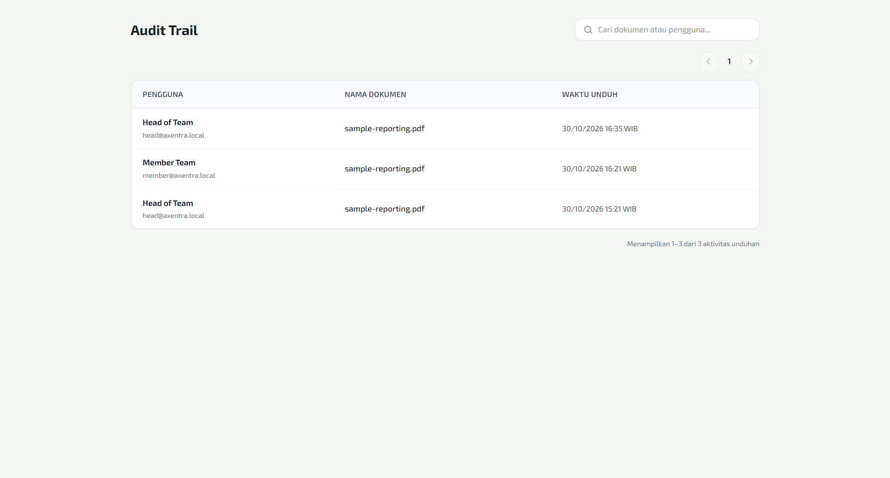

# Acceptance Evidence: FE-S4-02 (Build download audit trail page)

## Status: Passed

- **Card ID**: `FE-S4-02`
- **Acceptance Criteria**: `AC-12.01` (Tracking Log Unduhan)
- **PIC**: Aiman
- **Tech Lead / Approver**: Arya Isnaidi
- **Date**: 2026-10-30

### 1. Verification Walkthrough (AC-12.01)

Walkthrough dijalankan langsung pada stack lokal terintegrasi (Hono API, MinIO, PostgreSQL, Redis, dan React/Vite Web) dengan backend `BE-S4-02` (`GET /api/v1/audit/downloads`) yang telah di-merge ke `dev`:

| Atribut                   | Rincian                                                                                                                                                                                                                                                                                                                            |
| ------------------------- | ---------------------------------------------------------------------------------------------------------------------------------------------------------------------------------------------------------------------------------------------------------------------------------------------------------------------------------- |
| **Environment**           | Local Axentra stack (Bun 1.3.14, Chrome, Windows 11)                                                                                                                                                                                                                                                                               |
| **Role / Akun**           | `head_of_team` (`head@axentra.local`), diautentikasi melalui form login resmi                                                                                                                                                                                                                                                      |
| **Data Diuji**            | Peristiwa unduhan nyata pada dokumen `sample-reporting.pdf` yang dicatat melalui pemanggilan API `GET /api/v1/documents/:id/download`                                                                                                                                                                                              |
| **Hasil yang Diharapkan** | Saat Head of Team membuka halaman Audit Trail, langsung tampil tabel yang memperlihatkan rincian: Siapa (User), Apa (Nama Dokumen), dan Kapan (Waktu Unduh)                                                                                                                                                                        |
| **Hasil yang Diamati**    | Halaman `/audit-trail` langsung menampilkan tabel aktivitas unduhan dengan kolom Pengguna, Nama Dokumen, dan Waktu Unduh (format WIB). Log unduhan dari pengguna (termasuk `Member Team` dan `Head of Team`) tampil terurut waktu terbaru. Komponen tidak menduplikasi sidebar dan siap disematkan ke dalam `AppShell` (FE-S4-07). |

### 2. Screenshot Bukti Runtime

Tangkapan layar live runtime tersimpan di:
[`docs/screenshots/FE-S4-02/audit-trail-live.png`](audit-trail-live.png)

### 3. Automated Quality Gate

- `bun run complete-check`: **Passed 100%**
- `apps/web/test/audit-trail.integration.test.tsx`: 8 tes integrasi mencakup pembuktian AC-12.01 pada tabel utama, filter pencarian multi-field (nama & email), paginasi sinkron `pageSize`, penanganan galat 403, dan proteksi rute terhadap role yang tidak diizinkan.
- `apps/web/test/audit-trail.api.test.ts`: 2 unit test memvalidasi request endpoint `limit=100` dan penolakan payload yang tidak sesuai kontrak skema.
