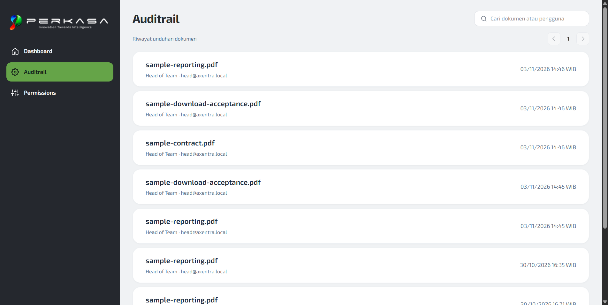
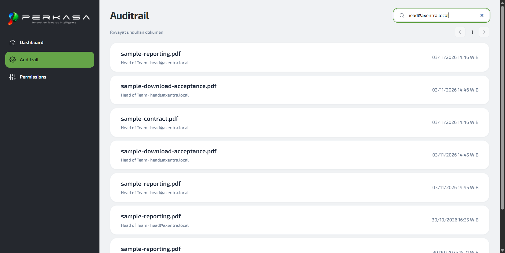
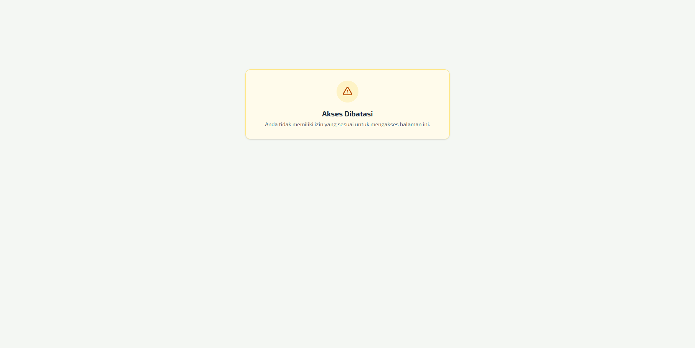

# Acceptance Evidence: FE-S4-02 (Build download audit trail page)

## Status: Recorded, release pending

- **Card ID**: `FE-S4-02`
- **Acceptance Criteria**: `AC-12.01` (Tracking Log Unduhan)
- **Prepared by**: Aiman (PIC)
- **Sign-Off / Approver**: Arya Isnaidi (Tech Lead) — _pending release sign-off_

---

### Run 4 — Walkthrough AC-12.01 pada head `9fca9b7` (2026-11-03)

Walkthrough dijalankan melalui Chromium/Chrome DevTools MCP pada stack lokal terintegrasi (Bun 1.4.3, PostgreSQL, Redis, MinIO/Docker Desktop 29.6.1, API `http://localhost:3001`, Web `http://localhost:5173`). Login Head of Team memakai UI resmi.

**SHA kode diuji:** `9fca9b7725a3740cada5ab8493338085f4e5ac37`. Commit dokumentasi/screenshot: `8c1b25ac8239c63b01fa859fc79d747b8cf9f6bf`.

**Data API nyata:** Dua unduhan single-file sukses (`sample-reporting.pdf` dan `sample-download-acceptance.pdf`); percobaan Member Team mengunduh `sample-contract.pdf` ditolak HTTP 403 dan tidak membuat audit event; bulk download Head of Team atas tiga dokumen menghasilkan HTTP 200 ZIP dan tiga event audit. Total lima event baru dari API untuk tiga dokumen, ditambah tiga event lama. Secara terpisah, delapan row sintetis sempat dimasukkan langsung ke DB untuk uji pagination 11 event; row tersebut telah dihapus kembali. Uji pagination tersebut membuktikan perilaku UI, bukan jalur pencatatan unduhan API.

```text
AC:          AC-12.01 (Tracking Log Unduhan)
Card:        FE-S4-02
Commit kode: 9fca9b7725a3740cada5ab8493338085f4e5ac37
Commit bukti:8c1b25ac8239c63b01fa859fc79d747b8cf9f6bf
Environment: local, Web http://localhost:5173, API http://localhost:3001, Bun 1.4.3, Docker Desktop 29.6.1, Chromium
Role:        head_of_team; member_team
Input:       Dua unduhan single-file dan satu bulk download melalui API untuk tiga dokumen sintetis
Status:      Recorded, release pending (sign-off akhir oleh Arya Isnaidi)
```

| Langkah | Deskripsi uji                                                                                                               | Hasil yang diharapkan                                                               | Hasil yang diamati                                                                                                                                                                                  | Status             |
| ------- | --------------------------------------------------------------------------------------------------------------------------- | ----------------------------------------------------------------------------------- | --------------------------------------------------------------------------------------------------------------------------------------------------------------------------------------------------- | ------------------ |
| **A**   | Daftar utama: satu kartu per event; dokumen, user, waktu WIB. Unduhan berulang atas dokumen sama tetap jadi kartu terpisah. | Semua field Siapa/Apa/Kapan per event terlihat.                                     | API menghasilkan lima event baru untuk tiga dokumen; bersama tiga event lama, daftar menampilkan delapan kartu. Dokumen berulang tampil sebagai event terpisah.                                     | **Pass**           |
| **B**   | Hitungan sesuai kartu dan rentang.                                                                                          | `Menampilkan x–y dari N aktivitas unduhan`.                                         | Ditampilkan `Menampilkan 1–8 dari 8 aktivitas unduhan`; delapan kartu terlihat.                                                                                                                     | **Pass**           |
| **C**   | Klik kartu, cek drawer, fokus awal, scroll lock.                                                                            | Drawer terbuka; fokus ke tombol tutup; background terkunci.                         | Drawer `Detail Log` terbuka dengan backdrop blur; fokus ke `Tutup detail log`; body overflow `hidden`. Log drawer memuat event dokumen yang sedang tampil di halaman.                               | **Pass**           |
| **D**   | Tekan Tab/Shift+Tab.                                                                                                        | Fokus tetap di dalam drawer.                                                        | Snapshot sebelum dan sesudah keypress tetap melaporkan tombol tutup sebagai fokus; perpindahan urutan fokus tidak dapat diamati dari snapshot, sehingga traversal penuh belum terverifikasi manual. | **Partial**        |
| **E**   | Escape menutup drawer.                                                                                                      | Fokus kembali ke kartu pemicu dan scroll pulih.                                     | Drawer tertutup; fokus kembali ke kartu pemicu; body scroll dipulihkan.                                                                                                                             | **Pass**           |
| **F**   | Cari nama user dan nama dokumen.                                                                                            | Hanya event yang cocok yang terlihat.                                               | `sample-contract` menampilkan satu event; `head@axentra.local` menampilkan tujuh hasil dari delapan event.                                                                                          | **Pass**           |
| **G**   | Cari teks acak.                                                                                                             | Pesan `Tidak ada hasil yang ditemukan`.                                             | Copy BA tampil persis; jumlah hasil nol.                                                                                                                                                            | **Pass**           |
| **H**   | Pagination >10 event.                                                                                                       | Halaman dua menampilkan sisa event; tombol berikutnya nonaktif di halaman terakhir. | UI diuji pada 11 event (8 row insert langsung ke DB + 3 lama): halaman pertama tampil 10 kartu, halaman dua satu kartu. Delapan row buatan sudah dihapus; tes ini hanya verifikasi pagination UI.   | **Pass (UI only)** |
| **I**   | Sidebar dan logo.                                                                                                           | Logo PERKASA; menu Auditrail aktif.                                                 | Logo PERKASA dan menu Auditrail aktif terlihat.                                                                                                                                                     | **Pass**           |
| **J**   | Login Member Team dan akses `/audit-trail`.                                                                                 | Role member ditolak.                                                                | Login `member@axentra.local` berhasil; route menampilkan `Akses Dibatasi`. Screenshot live disimpan.                                                                                                | **Pass**           |
| **K**   | Bahasa halaman/drawer.                                                                                                      | Label UI dalam Bahasa Indonesia.                                                    | Halaman dan drawer menggunakan Bahasa Indonesia; label sidebar `Permissions` masih berbahasa Inggris.                                                                                               | **Partial**        |

#### Screenshot Run 4

- [Daftar sesudah unduhan API nyata](audit-trail-2026-11-03-api-downloads.png)
- [Daftar uji pagination 11 event](audit-trail-2026-11-03-list.png)
- [Drawer Detail Log](audit-trail-2026-11-03-drawer.png)
- [Pencarian kosong](audit-trail-2026-11-03-search-empty.png)
- [Pencarian email user](audit-trail-2026-11-03-search-user.png)
- [Pagination halaman dua](audit-trail-2026-11-03-pagination-page2.png)
- [Akses Member Team ditolak](audit-trail-2026-11-03-member-blocked.png)








---

### Run 3 — Walkthrough UI AppShell & Drawer (Commit `918496346ecf45ba972b076319613080b79ac516`, 2026-11-02)

Historical walkthrough from the pre-accessibility-fix commit. It demonstrated the shell and drawer with local API data, but does not verify the current review head `7920bda` or the Round 3 changes. Re-run is blocked in the current environment because Docker Desktop's Linux engine is unavailable; API startup returns `ECONNREFUSED`.

| Atribut         | Rincian                                                                                                                                                                                                         |
| --------------- | --------------------------------------------------------------------------------------------------------------------------------------------------------------------------------------------------------------- |
| **Commit**      | `918496346ecf45ba972b076319613080b79ac516` (short `9184963`); historical only, not the current head.                                                                                                            |
| **Environment** | Historical local Axentra stack, Bun 1.4.3, Windows 11, Chromium (Chrome DevTools MCP).                                                                                                                          |
| **Role**        | Historical local `head_of_team` (`head@axentra.local`).                                                                                                                                                         |
| **Input**       | Historically three API download events for `sample-reporting.pdf`; no upload/Admin data was included because the endpoint covers downloads only.                                                                |
| **Expected**    | Head of Team sees each download event's user, document, and time; selecting an event opens the detail drawer and blurred backdrop.                                                                              |
| **Observed**    | Historical UI showed the shared shell and drawer with three download events. Per-event main-list presentation, focus containment, and return-to-trigger behavior were not verified there.                       |
| **Result**      | Historical walkthrough only. **Current-head re-verification: Blocked** — Docker engine unavailable (`docker compose ...` cannot connect to `dockerDesktopLinuxEngine`); API startup failed with `ECONNREFUSED`. |
| **Screenshot**  | Historical screenshots [`audit-trail-live.png`](audit-trail-live.png) and [`audit-trail-drawer-live.png`](audit-trail-drawer-live.png); not evidence for the current head.                                      |


#### Pending current-head re-verification

Run the AC-12.01 browser flow on the final pushed commit after Docker Desktop is available. Record the full commit SHA, environment, Head of Team test account, API-backed data, per-event main list, drawer focus containment/return, and fresh screenshots. Until then, AC-12.01 live verification remains **Blocked / release pending**.

---

### Run 2 — Walkthrough Round 2 (Commit `4611066e319e4d836daf9c94b2a25dda9e59080b`)

Dijalankan pada stack lokal terintegrasi (Hono API, MinIO, PostgreSQL, Redis, React/Vite Web) dengan backend `BE-S4-02` (`GET /api/v1/audit/downloads`) yang telah di-merge ke `dev`:

| Atribut                   | Rincian                                                                                                                                                                                               |
| ------------------------- | ----------------------------------------------------------------------------------------------------------------------------------------------------------------------------------------------------- |
| **Commit**                | `4611066e319e4d836daf9c94b2a25dda9e59080b`                                                                                                                                                            |
| **Date**                  | 2026-11-02                                                                                                                                                                                            |
| **Environment**           | Local Axentra stack (Bun 1.4.3, Chrome 155, Windows 11; repo packageManager pin: bun@1.4.3)                                                                                                           |
| **Role / Akun**           | `head_of_team` (`head@axentra.local`), diautentikasi melalui form login resmi                                                                                                                         |
| **Data Diuji**            | Peristiwa unduhan pada dokumen `sample-reporting.pdf` melalui API nyata `GET /api/v1/documents/:id/download`                                                                                          |
| **Hasil yang Diharapkan** | Saat Head of Team membuka `/audit-trail`, tampil tabel aktivitas unduhan: Siapa (User), Apa (Nama Dokumen), dan Kapan (Waktu Unduh). Paginasi server dan navigasi multi-halaman berfungsi semestinya. |
| **Hasil yang Diamati**    | Tabel menampilkan kolom Pengguna, Nama Dokumen, dan Waktu Unduh (format WIB). Teks paginasi terhubung ke metadata server. Kontrol nav aksesibel dan tidak menduplikasi sidebar (`13-app-shell.md`).   |
| **Result**                | Pass                                                                                                                                                                                                  |
| **Screenshot**            | [`docs/screenshots/FE-S4-02/audit-trail-round2-live.png`](audit-trail-round2-live.png)                                                                                                                |


---

### Run 1 — Walkthrough Historis Round 1 (Commit `2ddb07a24514107169a1c7436c94f8c69920f13e`)

- **Commit**: `2ddb07a24514107169a1c7436c94f8c69920f13e`
- **Date**: 2026-10-30
- **Environment**: Local Axentra stack (Bun 1.3.14, Chrome, Windows 11)
- **Role**: `head_of_team` (`head@axentra.local`)
- **Result**: Pass (tabel tampil langsung saat halaman dibuka; paginasi masih memakai batas client-side 100 event)
- **Screenshot**: [`docs/screenshots/FE-S4-02/audit-trail-live.png`](audit-trail-live.png)

---

### Quality Gate (Commit `4611066e319e4d836daf9c94b2a25dda9e59080b`)

- `bun run complete-check`: **Passed 100%** under Bun 1.4.3 (488 API + 71 Worker + 272 Web tests pass; type-check, oxlint 0 error/warning, oxfmt compliant, build all pass).
- `apps/web/test/audit-trail.api.test.ts`: 7 tes memvalidasi paginasi server, parameter `page` dan `limit`, serta penolakan metadata atau payload yang cacat.
- `apps/web/test/audit-trail.integration.test.tsx`: 9 tes integrasi memverifikasi tabel AC-12.01, paginasi server ke halaman 11 (> 100 items), filter pencarian pada halaman aktif, penolakan auto-retry pada 403, dan pemblokiran role `member_team`/`admin`.

_Catatan: Sesuai docs/E2E_TESTING.md:177-183, catatan bukti ini disiapkan oleh PIC (Aiman) dan berstatus "Recorded, release pending" sampai persetujuan/sign-off akhir dicatat oleh Arya Isnaidi (Tech Lead)._
