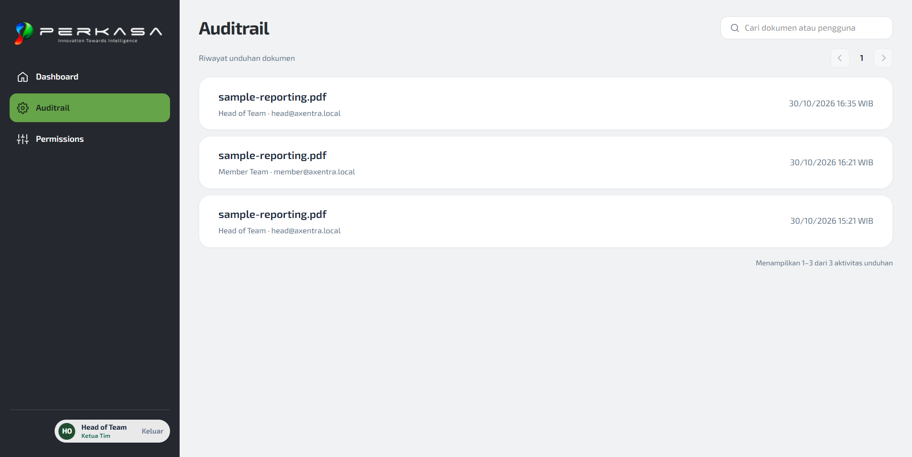
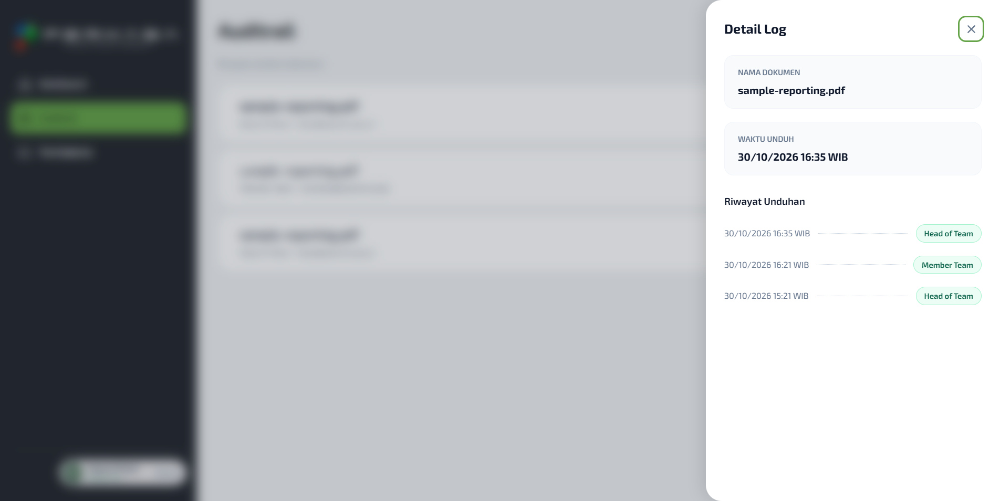
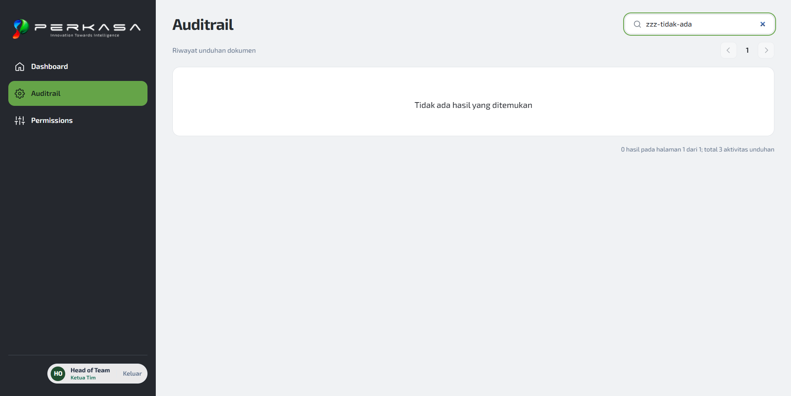
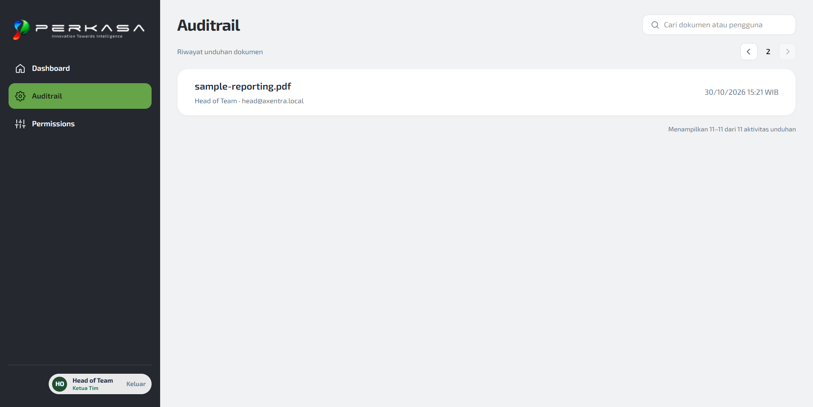
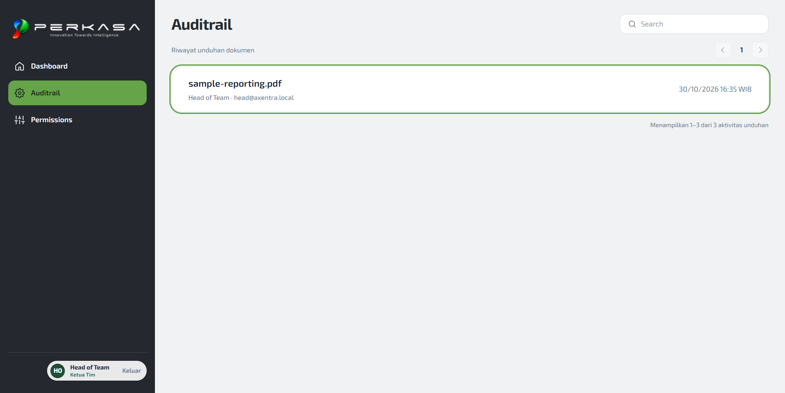
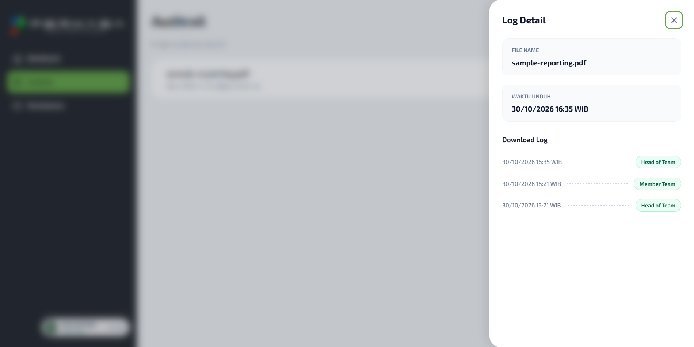

# Acceptance Evidence: FE-S4-02 (Build download audit trail page)

## Status: Recorded, release pending

- **Card ID**: `FE-S4-02`
- **Acceptance Criteria**: `AC-12.01` (Tracking Log Unduhan)
- **Prepared by**: Aiman (PIC)
- **Sign-Off / Approver**: Arya Isnaidi (Tech Lead) — _pending release sign-off_

---

### Run 4 — Walkthrough AC-12.01 pada head 9fca9b7 (2026-11-03)

Dijalankan secara interaktif melalui browser Chromium lokal (Chrome DevTools MCP) terhadap stack lokal terintegrasi (Bun 1.4.3, PostgreSQL, Redis, MinIO di Docker Desktop 29.6.1, Hono API `http://localhost:3001`, React/Vite Web `http://localhost:5173`). Walkthrough memakai login UI resmi untuk akun seed `head_of_team`; fixture dokumen sintetis `sample-reporting.pdf`; 11 audit event tersimpan di database lokal.

```text
AC:          AC-12.01 (Tracking Log Unduhan)
Card:        FE-S4-02
Commit:      9fca9b7725a3740cada5ab8493338085f4e5ac37
Environment: local, Web http://localhost:5173, API http://localhost:3001, Bun 1.4.3, Docker Desktop 29.6.1, Chromium
Role:        head_of_team (head@axentra.local, login UI resmi); member_team route check attempted
Input:       sample-reporting.pdf (fixture sintetis), 11 event unduhan
Status:      Recorded, release pending (sign-off akhir oleh Arya Isnaidi)
```

| Langkah | Deskripsi Uji                                            | Hasil yang Diharapkan                                                                                                                                               | Hasil yang Diamati                                                                                                                                                                                                                        | Status                  |
| ------- | -------------------------------------------------------- | ------------------------------------------------------------------------------------------------------------------------------------------------------------------- | ----------------------------------------------------------------------------------------------------------------------------------------------------------------------------------------------------------------------------------------- | ----------------------- |
| **A**   | Lihat daftar utama                                       | Satu kartu per event unduhan; menampilkan nama dokumen, pengguna, dan waktu `dd/mm/yyyy HH:mm WIB`. Dua event untuk dokumen sama tampil sebagai dua kartu terpisah. | Halaman 1 menampilkan 10 kartu event individual (dari 11 event di DB); `sample-reporting.pdf` tampil dengan pengguna dan waktu WIB per event.                                                                                             | **Pass**                |
| **B**   | Teks hitungan di bawah daftar                            | `Menampilkan x–y dari N aktivitas unduhan`; jumlah kartu sama dengan `y − x + 1`.                                                                                   | Halaman 1: `Menampilkan 1–10 dari 11 aktivitas unduhan` (10 kartu). Halaman 2: `Menampilkan 11–11 dari 11 aktivitas unduhan` (1 kartu).                                                                                                   | **Pass**                |
| **C**   | Klik satu kartu                                          | Drawer `Detail Log` terbuka; fokus berpindah ke tombol tutup; scroll latar belakang terkunci.                                                                       | Drawer dialog terbuka dengan backdrop blur; fokus otomatis ke `Tutup detail log`; `document.body.style.overflow` menjadi `hidden`.                                                                                                        | **Pass**                |
| **D**   | Tekan Tab/Shift+Tab di drawer                            | Fokus tetap di drawer, tidak keluar ke halaman di belakang.                                                                                                         | Snapshot browser setelah Tab dan Shift+Tab menunjukkan fokus tetap pada tombol `Tutup detail log` di dalam drawer.                                                                                                                        | **Pass**                |
| **E**   | Tekan Escape                                             | Drawer tertutup; fokus kembali ke kartu pemicu; scroll kembali normal.                                                                                              | Dialog tertutup; fokus keyboard kembali tepat ke kartu pemicu; body scroll dipulihkan.                                                                                                                                                    | **Pass**                |
| **F**   | Cari nama pengguna                                       | Hanya event cocok yang tampil.                                                                                                                                      | Belum diverifikasi interaktif: pemeriksaan alat browser tidak berhasil mengosongkan input type=search secara deterministik. Presenter/unit code membatasi filter ke halaman server yang aktif.                                            | **Not verified**        |
| **G**   | Cari teks acak `zzz-tidak-ada`                           | Tertulis `Tidak ada hasil yang ditemukan`.                                                                                                                          | Pesan BA tampil persis; hitungan menunjukkan `0 hasil pada halaman 1 dari 1; total 3 aktivitas unduhan`.                                                                                                                                  | **Pass**                |
| **H**   | Paginasi dengan 11 event                                 | Halaman 2 memuat event lebih lama; tombol sebelumnya aktif; tombol berikutnya nonaktif dengan tooltip `Sudah di halaman terakhir`.                                  | Halaman 1: 10 dari 11; setelah klik berikutnya halaman 2 dari 2 menampilkan event ke-11, tombol sebelumnya aktif, tombol berikutnya nonaktif dan berlabel `Sudah di halaman terakhir`.                                                    | **Pass**                |
| **I**   | Sidebar                                                  | Menu `Auditrail` aktif; logo PERKASA tampil.                                                                                                                        | Logo PERKASA tampil; menu `Auditrail` memiliki state aktif/highlight.                                                                                                                                                                     | **Pass**                |
| **J**   | Logout, login sebagai `member_team`, buka `/audit-trail` | Halaman riwayat tidak dapat diakses oleh role yang tidak diizinkan.                                                                                                 | **Not verified**: akun `member@axentra.local` menolak password uji dengan pesan `Email atau kata sandi salah`; tanpa login, akses membuka halaman login. Test integrasi role gate memverifikasi `member_team` diblokir tanpa request API. | **Not verified (live)** |
| **K**   | Periksa seluruh teks halaman/drawer                      | Tidak ada label UI bahasa Inggris, selain title tab browser.                                                                                                        | Label dan pesan yang diuji dalam bahasa Indonesia.                                                                                                                                                                                        | **Pass**                |

#### Screenshot Bukti Run 4:

- [Daftar utama — 10 event per halaman](audit-trail-2026-11-03-list.png)
- [Drawer Detail Log](audit-trail-2026-11-03-drawer.png)
- [Pencarian kosong](audit-trail-2026-11-03-search-empty.png)
- [Paginasi halaman 2](audit-trail-2026-11-03-pagination-page2.png)






---

### Run 3 — Walkthrough UI AppShell & Drawer (Commit `918496346ecf45ba972b076319613080b79ac516`, 2026-11-02)

Historical walkthrough from the pre-accessibility-fix commit. It demonstrated the shell and drawer with local API data, but does not verify the current review head `7920bda` or the Round 3 changes. Re-run is blocked in the current environment because Docker Desktop's Linux engine is unavailable; API startup returns `ECONNREFUSED`.

| Atribut         | Rincian                                                                                                                                                                                                         |
| --------------- | --------------------------------------------------------------------------------------------------------------------------------------------------------------------------------------------------------------- |
| **Commit**      | `918496346ecf45ba972b076319613080b79ac516` (short `9184963`); historical only, not the current head.                                                                                                            |
| **Environment** | Historical local Axentra stack, Bun 1.4.3, Windows 11, Chromium (Chrome DevTools MCP).                                                                                                                          |
| **Role**        | Historical local `head_of_team` (`head@axentra.local`).                                                                                                                                                         |
| **Input**       | Historically three API download events for `sample-reporting.pdf`; no upload/Admin data was included because the endpoint covers downloads only.                                                                |
| **Expected**    | Head of Team sees each download event's user, document, and time; selecting an event opens the detail drawer and blurred backdrop.                                                                              |
| **Observed**    | Historical UI showed the shared shell and drawer with three download events. Per-event main-list presentation, focus containment, and return-to-trigger behavior were not verified there.                       |
| **Result**      | Historical walkthrough only. **Current-head re-verification: Blocked** — Docker engine unavailable (`docker compose ...` cannot connect to `dockerDesktopLinuxEngine`); API startup failed with `ECONNREFUSED`. |
| **Screenshot**  | Historical screenshots [`audit-trail-live.png`](audit-trail-live.png) and [`audit-trail-drawer-live.png`](audit-trail-drawer-live.png); not evidence for the current head.                                      |





#### Pending current-head re-verification

Run the AC-12.01 browser flow on the final pushed commit after Docker Desktop is available. Record the full commit SHA, environment, Head of Team test account, API-backed data, per-event main list, drawer focus containment/return, and fresh screenshots. Until then, AC-12.01 live verification remains **Blocked / release pending**.

---

### Run 2 — Walkthrough Round 2 (Commit `4611066e319e4d836daf9c94b2a25dda9e59080b`)

Dijalankan pada stack lokal terintegrasi (Hono API, MinIO, PostgreSQL, Redis, React/Vite Web) dengan backend `BE-S4-02` (`GET /api/v1/audit/downloads`) yang telah di-merge ke `dev`:

| Atribut                   | Rincian                                                                                                                                                                                               |
| ------------------------- | ----------------------------------------------------------------------------------------------------------------------------------------------------------------------------------------------------- |
| **Commit**                | `4611066e319e4d836daf9c94b2a25dda9e59080b`                                                                                                                                                            |
| **Date**                  | 2026-11-02                                                                                                                                                                                            |
| **Environment**           | Local Axentra stack (Bun 1.4.3, Chrome 155, Windows 11; repo packageManager pin: bun@1.4.3)                                                                                                           |
| **Role / Akun**           | `head_of_team` (`head@axentra.local`), diautentikasi melalui form login resmi                                                                                                                         |
| **Data Diuji**            | Peristiwa unduhan pada dokumen `sample-reporting.pdf` melalui API nyata `GET /api/v1/documents/:id/download`                                                                                          |
| **Hasil yang Diharapkan** | Saat Head of Team membuka `/audit-trail`, tampil tabel aktivitas unduhan: Siapa (User), Apa (Nama Dokumen), dan Kapan (Waktu Unduh). Paginasi server dan navigasi multi-halaman berfungsi semestinya. |
| **Hasil yang Diamati**    | Tabel menampilkan kolom Pengguna, Nama Dokumen, dan Waktu Unduh (format WIB). Teks paginasi terhubung ke metadata server. Kontrol nav aksesibel dan tidak menduplikasi sidebar (`13-app-shell.md`).   |
| **Result**                | Pass                                                                                                                                                                                                  |
| **Screenshot**            | [`docs/screenshots/FE-S4-02/audit-trail-round2-live.png`](audit-trail-round2-live.png)                                                                                                                |


---

### Run 1 — Walkthrough Historis Round 1 (Commit `2ddb07a24514107169a1c7436c94f8c69920f13e`)

- **Commit**: `2ddb07a24514107169a1c7436c94f8c69920f13e`
- **Date**: 2026-10-30
- **Environment**: Local Axentra stack (Bun 1.3.14, Chrome, Windows 11)
- **Role**: `head_of_team` (`head@axentra.local`)
- **Result**: Pass (tabel tampil langsung saat halaman dibuka; paginasi masih memakai batas client-side 100 event)
- **Screenshot**: [`docs/screenshots/FE-S4-02/audit-trail-live.png`](audit-trail-live.png)

---

### Quality Gate (Commit `4611066e319e4d836daf9c94b2a25dda9e59080b`)

- `bun run complete-check`: **Passed 100%** under Bun 1.4.3 (488 API + 71 Worker + 272 Web tests pass; type-check, oxlint 0 error/warning, oxfmt compliant, build all pass).
- `apps/web/test/audit-trail.api.test.ts`: 7 tes memvalidasi paginasi server, parameter `page` dan `limit`, serta penolakan metadata atau payload yang cacat.
- `apps/web/test/audit-trail.integration.test.tsx`: 9 tes integrasi memverifikasi tabel AC-12.01, paginasi server ke halaman 11 (> 100 items), filter pencarian pada halaman aktif, penolakan auto-retry pada 403, dan pemblokiran role `member_team`/`admin`.

_Catatan: Sesuai docs/E2E_TESTING.md:177-183, catatan bukti ini disiapkan oleh PIC (Aiman) dan berstatus "Recorded, release pending" sampai persetujuan/sign-off akhir dicatat oleh Arya Isnaidi (Tech Lead)._
