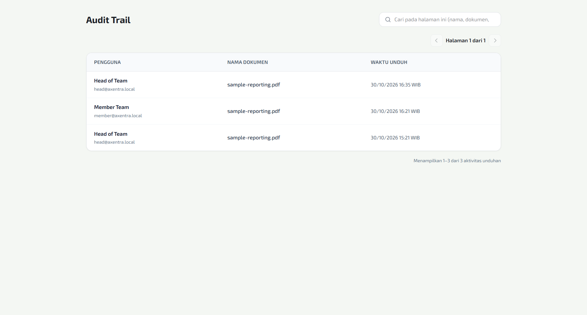

# Acceptance Evidence: FE-S4-02 (Build download audit trail page)

## Status: Recorded, release pending

- **Card ID**: `FE-S4-02`
- **Acceptance Criteria**: `AC-12.01` (Tracking Log Unduhan)
- **Prepared by**: Aiman (PIC)
- **Sign-Off / Approver**: Arya Isnaidi (Tech Lead) — _pending release sign-off_

---

### Run 2 — Walkthrough Round 2 (Commit `4611066e319e4d836daf9c94b2a25dda9e59080b`)

Dijalankan pada stack lokal terintegrasi (Hono API, MinIO, PostgreSQL, Redis, React/Vite Web) dengan backend `BE-S4-02` (`GET /api/v1/audit/downloads`) yang telah di-merge ke `dev`:

| Atribut                   | Rincian                                                                                                                                                                                               |
| ------------------------- | ----------------------------------------------------------------------------------------------------------------------------------------------------------------------------------------------------- |
| **Commit**                | `4611066e319e4d836daf9c94b2a25dda9e59080b`                                                                                                                                                            |
| **Date**                  | 2026-11-02                                                                                                                                                                                            |
| **Environment**           | Local Axentra stack (Bun 1.4.3, Chrome 155, Windows 11; repo packageManager pin: bun@1.4.3)                                                                                                           |
| **Role / Akun**           | `head_of_team` (`head@axentra.local`), diautentikasi melalui form login resmi                                                                                                                         |
| **Data Diuji**            | Peristiwa unduhan pada dokumen `sample-reporting.pdf` melalui API nyata `GET /api/v1/documents/:id/download`                                                                                          |
| **Hasil yang Diharapkan** | Saat Head of Team membuka `/audit-trail`, tampil tabel aktivitas unduhan: Siapa (User), Apa (Nama Dokumen), dan Kapan (Waktu Unduh). Paginasi server dan navigasi multi-halaman berfungsi semestinya. |
| **Hasil yang Diamati**    | Tabel menampilkan kolom Pengguna, Nama Dokumen, dan Waktu Unduh (format WIB). Teks paginasi terhubung ke metadata server. Kontrol nav aksesibel dan tidak menduplikasi sidebar (`13-app-shell.md`).   |
| **Result**                | Pass                                                                                                                                                                                                  |
| **Screenshot**            | [`docs/screenshots/FE-S4-02/audit-trail-round2-live.png`](audit-trail-round2-live.png)                                                                                                                |

---

### Run 1 — Walkthrough Historis Round 1 (Commit `2ddb07a24514107169a1c7436c94f8c69920f13e`)

- **Commit**: `2ddb07a24514107169a1c7436c94f8c69920f13e`
- **Date**: 2026-10-30
- **Environment**: Local Axentra stack (Bun 1.3.14, Chrome, Windows 11)
- **Role**: `head_of_team` (`head@axentra.local`)
- **Result**: Pass (tabel tampil langsung saat halaman dibuka; paginasi masih memakai batas client-side 100 event)
- **Screenshot**: [`docs/screenshots/FE-S4-02/audit-trail-live.png`](audit-trail-live.png)

---

### Quality Gate (Commit `4611066e319e4d836daf9c94b2a25dda9e59080b`)

- `bun run complete-check`: **Passed 100%** under Bun 1.4.3 (488 API + 71 Worker + 272 Web tests pass; type-check, oxlint 0 error/warning, oxfmt compliant, build all pass).
- `apps/web/test/audit-trail.api.test.ts`: 7 tes memvalidasi paginasi server, parameter `page` dan `limit`, serta penolakan metadata atau payload yang cacat.
- `apps/web/test/audit-trail.integration.test.tsx`: 9 tes integrasi memverifikasi tabel AC-12.01, paginasi server ke halaman 11 (> 100 items), filter pencarian pada halaman aktif, penolakan auto-retry pada 403, dan pemblokiran role `member_team`/`admin`.

_Catatan: Sesuai docs/E2E_TESTING.md:177-183, catatan bukti ini disiapkan oleh PIC (Aiman) dan berstatus "Recorded, release pending" sampai persetujuan/sign-off akhir dicatat oleh Arya Isnaidi (Tech Lead)._
