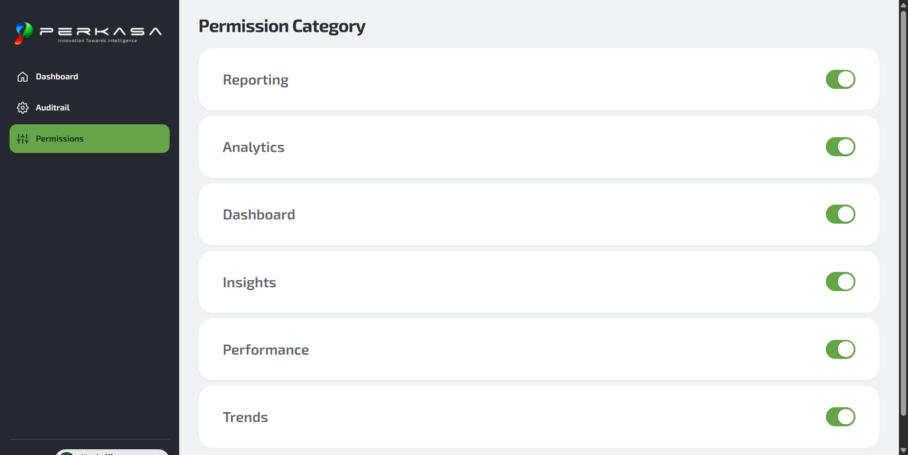

# Acceptance Evidence: FE-S4-03 (Build permission category page)

## Status: In Review (Dependensi Backend BE-S4-03 & BE-S4-04 Merged)

- **Card ID**: `FE-S4-03`
- **Acceptance Criteria**: `AC-13.01` (Pembatasan Hak Download berdasarkan kategori dokumen)
- **Prepared by**: Aiman (PIC)
- **Sign-Off / Approver**: Arya Isnaidi (Tech Lead) — _pending release sign-off_
- **Date**: 2026-11-04

---

### 1. Status Dependensi

Sesuai `docs/E2E_TESTING.md:178` ("Mark `Blocked`, not `Pass`, when a dependency is missing"):

| Komponen Dependensi           | Status     | Keterangan                                                                                                            |
| ----------------------------- | ---------- | --------------------------------------------------------------------------------------------------------------------- |
| **Frontend UI (FE-S4-03)**    | **Ready**  | Komponen view, presenter, API client, dan styling switch selesai diimplementasikan tanpa mock/preview palsu.          |
| **Backend List (BE-S4-03)**   | **Merged** | Endpoint `GET /api/v1/permission-categories` telah di-merge ke branch `dev` (commit `c0f1a7d`, PR #56).               |
| **Backend Toggle (BE-S4-04)** | **Merged** | Endpoint `PATCH /api/v1/permission-categories/:categoryId` telah di-merge ke branch `dev` (commit `accf7f9`, PR #57). |

---

### 2. Automated Quality Gate

- `bun run complete-check`: **Passed 100%** under Bun 1.4.3 (495 API + 71 Worker + 269 Web + 279 Packages tests pass; type-check, oxlint 0 error/warning, oxfmt compliant, build all pass).
- `apps/web/test/permission-categories.api.test.ts`: 5 unit tests memvalidasi batas limit query `[PERMISSION_CATEGORIES_MIN_LIMIT, PERMISSION_CATEGORIES_MAX_LIMIT]`, pemanggilan endpoint `GET /permission-categories`, mutasi `PATCH /permission-categories/:categoryId` dengan payload `downloadEnabled: boolean`, serta penolakan respons malformed.
- `apps/web/test/permission-categories.view.test.tsx`: 8 view integration tests memverifikasi:
  - Tampilan daftar kategori dan sakelar (switch) izin unduh pada halaman.
  - Perubahan toggle izin dari inactive menjadi Active melalui panggilan PATCH API.
  - Penolakan akses HTTP 403 ("Akses Dibatasi") tanpa retry otomatis, tanpa kebocoran detail internal server, dan tanpa kemunculan teks empty state (F2).
  - Penanganan galat HTTP 404 sebagai error nyata tanpa menampilkan kategori fixture atau toggle palsu (F1).
  - Penanganan galat transien aman (500) dengan tombol "Coba lagi" manual.
  - Tampilan empty state saat belum ada kategori.
  - Pemblokiran role `member_team` dan `admin` pada level rute tanpa mengirim request API liar.

---

### 3. Visual & UI Alignment

- **Shared AppShell**: Menggunakan komponen `AppShell` bersama (`apps/web/src/app/app-shell.view.tsx`) sesuai `docs/technical-specs/13-app-shell.md`.
  - Sidebar kiri: background `#25282e`, logo PERKASA (`perkasa-logo-sidebar.png`), menu Dashboard, Auditrail (`/audit-trail`, F3 tertutup), dan menu Permission category aktif (`/permission-categories`) dengan background pill hijau `--sidebar-accent, #65a448` serta teks gelap. User badge di bagian bawah.
- **Header Konten**: `Permission category` (font weight 700, `#282d31`, size 30px / `1.875rem`).
- **Kartu Kategori**: Background putih `#ffffff`, border `#eef1f4`, border-radius 24px (`1.5rem`), min-height 105px (`6.5625rem`), padding horizontal 40px (`2.5rem`), tipografi nama kategori 24px (`1.5rem`) semi-bold `#5d6268`.
- **Switch Kontrol**:
  - Dimensi: 50px × 32px (`3.125rem × 2rem`), border-radius pill 9999px.
  - State aktif: background `--sidebar-accent, #65a448` dengan thumb diameter 26px di kanan.
  - State inaktif: background netral `#cbd5e1` dengan thumb di kiri.
  - State pending: opacity 0.65, kursor progress untuk mencegah double-trigger.
  - Aksesibilitas: native button dengan atribut semantik `role="switch"` dan `aria-checked`, label `aria-label="Izin unduh kategori {nama}"`.
- **Preview visual sintetis**: [`permission-category-live.png`](permission-category-live.png) — pratinjau visual desain UI, **bukan** bukti data API nyata atau persistensi database.

_Catatan: Catatan bukti ini disiapkan oleh PIC (Aiman). Seluruh dependensi backend (BE-S4-03 PR #56, BE-S4-04 PR #57) telah tersedia di branch integrasi `dev`._
