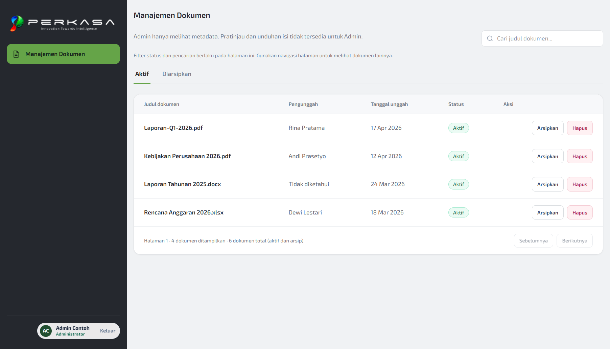
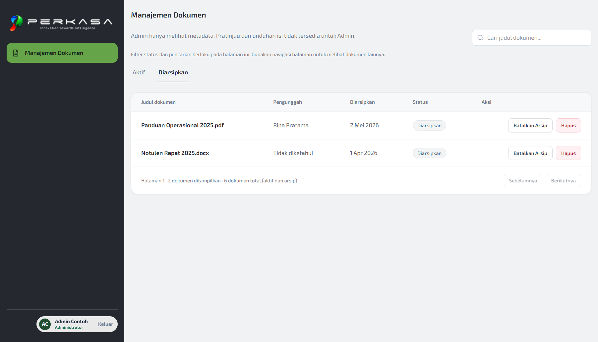
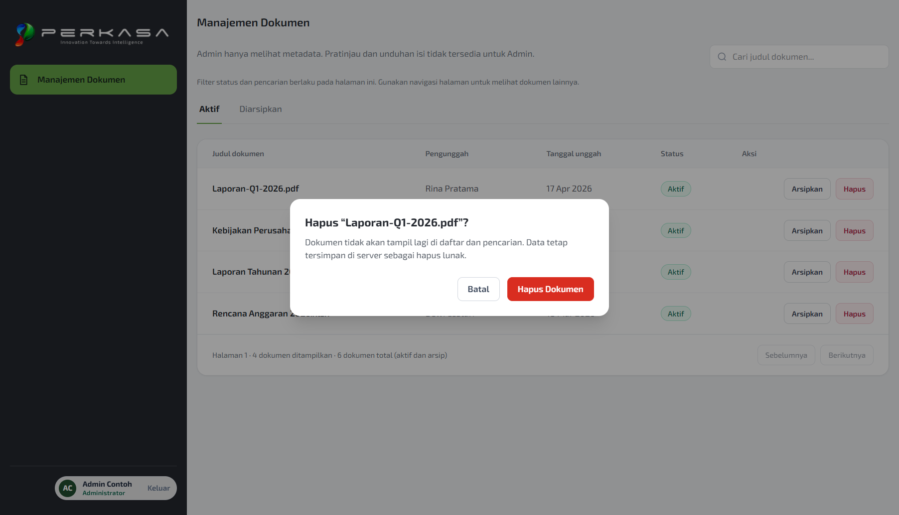

# Acceptance Evidence: FE-S4-06 (Build document management page)

## Status: Belum selesai — dependensi live BE-S4-07 blocked

- **Card ID**: `FE-S4-06`
- **Acceptance Criteria**: `PROP-ADM-AC-03.01` hingga `PROP-ADM-AC-03.05` (Manajemen Dokumen Admin)
- **PIC**: Aiman
- **Tech Lead / Approver**: Arya Isnaidi
- **Tanggal**: 2026-11-05
- **Branch**: `FE-S4-06-Build-document-management-page`

---

### 1. Status Dependensi dan Otorisasi

Sesuai aturan `docs/E2E_TESTING.md` ("Mark `Blocked`, not `Pass`, when a dependency is missing"):

| Komponen Dependensi            | Status      | Keterangan                                                                                                                                                                                                                                                                         |
| ------------------------------ | ----------- | ---------------------------------------------------------------------------------------------------------------------------------------------------------------------------------------------------------------------------------------------------------------------------------- |
| **Database Schema (DB-S4-01)** | **Merged**  | Kolom `users.status`, `documents.uploaded_by`, `documents.archived_at` telah tersedia di `dev` (PR #61, merge `2f22949`).                                                                                                                                                          |
| **Backend API (BE-S4-07)**     | **Blocked** | Endpoint `GET /api/v1/admin/documents`, `GET /api/v1/admin/documents/:id`, `POST /api/v1/admin/documents/:id/archive`, `POST /api/v1/admin/documents/:id/unarchive`, dan `DELETE /api/v1/admin/documents/:id` belum di-merge ke `dev`. Integrasi live tidak dapat dinyatakan Pass. |
| **Frontend UI (FE-S4-06)**     | **Ready**   | Komponen API client, presenter, view, dialog aksi (delete, archive, unarchive, metadata detail), dan menu AppShell selesai dibangun tanpa memalsukan integrasi langsung.                                                                                                           |

---

### 2. Keselarasan Kontrak API dan Tampilan Desain

1. **Keputusan Hak Akses Admin (2026-11-04, PROP-ADM-AC-05.02)**:
   - Admin hanya melihat metadata dokumen.
   - Tidak ada tombol pratinjau (preview), unduhan file (download), storage key, atau signed URL pada halaman Admin.
2. **Penanganan Dokumen Legacy (Keputusan O8, 2026-11-05)**:
   - Dokumen tanpa uploader (`ownerId: null`, `ownerName: null`) ditampilkan dengan teks "Tidak diketahui".
3. **Cakupan Filter dan Pencarian**:
   - Kontrak API `GET /api/v1/admin/documents` saat ini hanya mendukung `page` dan `limit`.
   - UI secara transparan memberikan keterangan bahwa pencarian judul dan tab status berlaku pada halaman yang sedang dimuat, tanpa memalsukan pencarian global seluruh basis data.
4. **Konfirmasi Tindakan**:
   - Hapus Dokumen (soft delete): Dialog konfirmasi dengan penjelasan bahwa data tetap tersimpan di server.
   - Arsipkan Dokumen: Dialog konfirmasi dengan penjelasan bahwa dokumen tidak akan tampil lagi di Member Team maupun Head of Team.
   - Batalkan Arsip: Dialog konfirmasi untuk mengembalikan dokumen ke daftar aktif.
   - Detail Metadata: Dialog modal semantik dengan focus trapping dan tombol Escape.

---

### 3. Automated Quality Gate

Hasil eksekusi `bun run complete-check`:

- **Type Check**: Lulus 100% pada semua package dan apps (`tsc --noEmit`).
- **Lint**: Lulus 100% (`oxlint .` 0 error, 0 warning).
- **Format**: Lulus 100% (`oxfmt --check .`).
- **Unit & Integration Tests**: Lulus 100% (507 API + 71 Worker + 307 Web + 290 Packages = 1175 tests pass).
- **Build**: Lulus 100% (Vite web build, Hono api bundle, BullMQ worker bundle).

Berkas pengujian spesifik FE-S4-06:

- `apps/web/test/admin-documents.api.test.ts` (4 unit tests):
  - Memverifikasi parsing data dan meta paginasi `listAdminDocuments`.
  - Memverifikasi pemanggilan endpoint `POST /admin/documents/:id/archive`.
  - Memverifikasi pengambilan detail metadata `GET /admin/documents/:id`.
  - Memverifikasi pemanggilan `DELETE /admin/documents/:id`.
- `apps/web/test/admin-documents.view.test.tsx` (8 integration tests):
  - `AC-03.01`: Menampilkan daftar dokumen beserta judul, pengunggah, dan status (termasuk dokumen legacy "Tidak diketahui").
  - `AC-03.01 & AC-03.05`: Berpindah ke tab Diarsipkan dan memverifikasi tombol Batalkan Arsip.
  - `AC-03.03`: Alur dialog konfirmasi arsip memicu mutasi archive.
  - `AC-03.05`: Alur dialog konfirmasi pembatalan arsip memicu mutasi unarchive.
  - `AC-03.04`: Alur dialog konfirmasi hapus lunak memicu mutasi delete.
  - `AC-03.02`: Dialog detail metadata dokumen menampilkan metadata tanpa affordance preview/download.
  - Proteksi Rute: Role selain `admin` (`member_team`) ditolak dengan pesan "Akses Dibatasi".
  - Penanganan Galat: Respons galat 500 menampilkan pesan dan tombol "Coba lagi" yang berfungsi.

---

### 4. Bukti Pratinjau Visual (Data Sintetis)

Tangkapan layar ini diambil langsung dari komponen aktual di peramban (`http://localhost:5173/admin/documents`) menggunakan data respons sintetis lokal karena backend `BE-S4-07` belum tersedia:

1. **Tab Dokumen Aktif**:
   
   - Berkas: [`preview-aktif-sintetis.png`](preview-aktif-sintetis.png)
   - Menampilkan AppShell Admin, menu aktif "Manajemen Dokumen", tab Aktif, tabel metadata dengan status pill hijau "Aktif", tombol Arsipkan dan Hapus, serta paginasi.

2. **Tab Dokumen Diarsipkan**:
   
   - Berkas: [`preview-diarsipkan-sintetis.png`](preview-diarsipkan-sintetis.png)
   - Menampilkan tab Diarsipkan aktif dengan indikator garis bawah hijau, kolom tanggal berubah menjadi "Diarsipkan", status pill abu-abu "Diarsipkan", tombol "Batalkan Arsip" dan "Hapus".

3. **Dialog Konfirmasi Hapus Dokumen**:
   
   - Berkas: [`preview-konfirmasi-hapus-sintetis.png`](preview-konfirmasi-hapus-sintetis.png)
   - Menampilkan modal semantik `<dialog>` konfirmasi soft delete dengan latar backdrop, teks penjelasan data tetap di server, tombol Batal dan Hapus Dokumen (merah).
